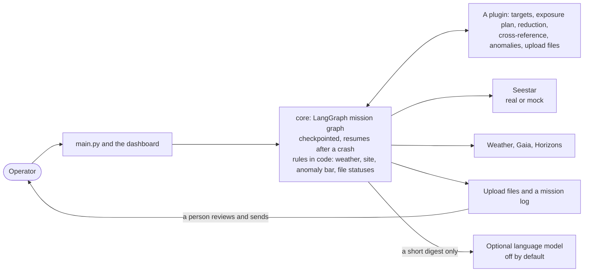

# 🔭 Astronomo

> **Mission.** Help amateur astronomers contribute meaningfully to real science.
> See [the mission and how we will know](docs/mission.md).

Astronomo is a free, open-source, auditable pipeline that runs a small telescope (Seestar S50 Pro) under supervision, end to end: **fetch a network's targets → check weather → observe → reduce → cross-reference → prepare upload files → screen for anomalies → keep a mission log**. The core is **domain-agnostic** (mission state, weather gating, hardware, telemetry, upload files); a science case is a *plugin* ([Plugins](#plugins)). A language model is optional, off by default, and never in charge of safety.

## The Goal

The aim is the full scientific loop: **propose** what to observe, **observe** it, **analyze** the data, **test** the findings, then **submit** or **rework** and go round again. A language model takes on that loop one small, checked decision at a time, and the safety interlocks always stay in code. [The roadmap](ROADMAP.md#phases) says which phase delivers which step.

The modest aim for one telescope is narrower, and it is what is built today: **take part in the networks, not rediscover what is known.** A 50 mm telescope supplies what the networks are short of, so Astronomo takes targets from their own lists: the AAVSO Target Tool (variable-star magnitudes), [ExoClock](https://www.exoclock.space/) and [NASA Exoplanet Watch](https://exoplanets.nasa.gov/exoplanet-watch/) (transit times), the [Minor Planet Center](https://minorplanetcenter.net/)'s NEO Confirmation Page and public Rubin alerts. Only the variable-star and transit plugins are meant for use. The **default product is a database-ready upload file** (AAVSO or ADES) that a person reviews and sends; **Astronomo never sends anything itself**. Every night gets a Markdown mission log, and an anomaly is flagged in it for a person to review. The concrete goal is on [the mission page](docs/mission.md#the-concrete-goal-what-astronomo-can-meaningfully-contribute).

**Status in short.** The pipeline works end to end in simulation and is covered by tests. On a real Seestar S50 Pro it has finished two short supervised variable-star visits, and the magnitudes agree with Gaia within their quoted errors. It has not yet done a clean 40-frame night, run a whole mission over station mode, produced a live AAVSO file, or seen a transit. [Status](docs/status.md) says, stage by stage, what has and has not been seen on a real telescope, and [what is not real yet](docs/status.md#what-is-not-real-yet) is the honest list of gaps.

> **Use at your own risk.** This software can drive a real telescope. It is provided as is, with no warranty, and the
> operator is responsible for the equipment. Pointing a telescope at or near the Sun can destroy its optics and sensor
> and cause eye injury; the built-in interlocks reduce that risk but do not remove it. Supervise the first runs, and read
> [Real hardware](docs/real-hardware.md) first.


*The dashboard's page for a finished mission, here a simulated one: the result, what it means, the file a person reviews (never sent by Astronomo) and the light curve. The star and the eclipse are practice data, not a real star. [More on the dashboard](#4-watch-it-in-the-dashboard-optional).*

## Quick start

Everything in this section runs with **no hardware, no API key and no cost**. To add a language model, see [Choose a model](docs/models.md#choose-a-model-local-cloud-or-none).

### 1. Install

```bash
cd astronomo
python3 install.py    # Python 3.10 or newer. Creates .venv, installs, writes .env, runs a fast simulation (the default plugin).
```

`install.py` asks only for an upload identity (observer name, AAVSO code, MPC station code, site). Leave any answer blank. It does not ask for a key, and it leaves the telescope mock on. By hand: `python3 -m venv .venv`, `source .venv/bin/activate`, `pip install -r requirements.txt`, and optionally `cp .env.example .env`. CI tests Python 3.10, 3.11, 3.12 and 3.13, each with a clean install of the newest libraries `requirements.txt` allows: langgraph 1.2, fastapi 0.115, and on 3.11 to 3.13 astropy 8.0 and photutils 3.x (3.10 gets astropy 6.1 and photutils 2.0, the newest that support it).

### 2. Run a simulated variable-star visit

```bash
python main.py --plugin variable_stars --simulate --fast   # under a minute: sub-second mock exposures
```

Drop `--fast` for real-length mock exposures (several minutes). Interrupt with Ctrl-C and run the same command again: the mission is checkpointed and **resumes** from the last completed node. `python main.py --list-plugins` lists the plugins; each page under [docs/plugins/](docs/plugins/) has its own commands.

`--simulate` = mock telescope **and** offline weather/catalogs (deterministic stand-ins, every record tagged `simulated`). `--simulate --live-services` keeps the telescope mocked but uses real Open-Meteo / JPL Horizons / Gaia. That exercises the network plumbing only: the synthetic images don't match the real sky, so catalog matches are meaningless in that mode.

### 3. Read the result

A successful run ends like this (numbers vary slightly with the clock). Simulated files are prefixed `SIMULATED_` and can never be marked ready to upload:

```
Mission m_20261120_222949_1537 finished: COMPLETE
  observations: 2
   - V1234 Lac (sim): A minimum: depth 27.8 %, duration 0.88 h, mid-time 2026-11-20 23:55 UTC, 10 comparison stars.
       cross-ref: eclipse on time: 11.300 +/- 0.030 mag, minimum at 2026-11-20 23:55 UTC.
  upload files ({'simulated': 2, ...}); none are sent, a person reviews each:
   - [simulated] AAVSO (WebObs) variable_star_photometry: .../results/SIMULATED_V1234Lacsim_2026-11-20_AAVSO_Extended.txt
  findings: .../results/findings_2026-11-20.md
  mission log: .../results/mission_log_2026-11-20.md
```

Output lands in `data/` (override with `ASTRONOMO_DATA_DIR`): `astronomo.sqlite` (telemetry), `checkpoints.sqlite` (LangGraph state), and per mission `missions/<id>/` with `frames/` (the FITS frames) and `results/`, the one folder to open: the upload files and a `manifest.json` (nothing in it has been sent), `findings_<night>.md` (what was measured, the quoted error, what the numbers mean and what to check before sending) and `mission_log_<night>.md` (which flags any anomaly at or above `ASTRONOMO_ANOMALY_MIN_SIGMA` for a person to review).

### 4. Watch it in the dashboard (optional)

Astronomo does not need a browser; step 2 is a complete run. To watch and to plan, run `python -m dashboard.api` in a second terminal and open [http://localhost:8765](http://localhost:8765). It serves the HTTP API (`/api/v1`) and the bundled React UI (no Node needed unless you change the React source). The pages are in [the dashboard guide](docs/dashboard.md), and the API contract is [docs/api.md](docs/api.md).

### 5. Before any real upload

Set `ASTRONOMO_OBSERVER_NAME`, `ASTRONOMO_AAVSO_OBS_CODE` and `ASTRONOMO_MPC_STATION_CODE` ([Configuration](docs/configuration.md#needed-before-a-real-upload); the AAVSO code is free, [how to request it](docs/runbooks/aavso-observer-code.md)). Without them a file is still written, but as a `DRAFT_` with the missing item listed as a blocker. To upload, you open the file and submit it yourself on the AAVSO's or the MPC's site.

## Connect a real Seestar

A Seestar S50 Pro (firmware 9.75) was connected over ASCOM Alpaca in two ways: **station mode**, where the telescope joins your home Wi-Fi and the computer keeps the internet (tested at the bench on 2026-11-20, not yet on the sky), and the telescope's own Wi-Fi, which is how it was first connected (2026-11-13) and has no internet. Two traps: station mode fails if your router uses `10.0.0.x`, and Alpaca has no password, so anyone on the network can send it commands. The steps, the router fix and the smoke test (`python main.py --hardware-check`) are on [Connect a real Seestar](docs/connect-a-seestar.md). Read [Real hardware](docs/real-hardware.md) and [the first-clean-night runbook](docs/runbooks/first-clean-night.md) before a mission.

## How it fits together



- **The plugin boundary.** `core/` and `tools/` know no science case. Adding one does not touch core ([Writing a plugin](docs/writing-a-plugin.md)).
- **Rules stay in code.** A plugin or a model cannot lower the weather gate, the site interlocks, the anomaly threshold or the rules for which upload files can be marked ready.
- **The model's role is small.** It sees only a short digest, never raw data, and today writes one thing, the observing rationale shown on the dashboard ([Language models](docs/models.md#language-models-optional)).

The full diagram, the step-by-step flow of a mission and the code layout are in [docs/architecture.md](docs/architecture.md).

## Plugins

A science case is a plugin. Four ship with Astronomo, and `variable_stars` is the one that has measured a magnitude on this telescope. Each page says what its numbers do and do not mean.

| Plugin | Status | Targets come from | Produces |
| --- | --- | --- | --- |
| [`variable_stars`](docs/plugins/variable_stars.md) | ready (default) | The AAVSO Target Tool's public list | One **AAVSO Extended** magnitude per visit |
| [`transit_finder`](docs/plugins/transit.md) | ready (simulation only) | ExoClock and NASA Exoplanet Watch, ranked by how stale each ephemeris is | One **AAVSO Exoplanet Report** per transit |
| [`asteroid_finder`](docs/plugins/asteroid.md) | **draft** | The MPC NEO Confirmation Page, else a labelled built-in list | **MPC ADES** astrometry, for matched tracks only |
| [`rubin_followup`](docs/plugins/rubin.md) | **draft** | Public Rubin alerts via the Fink broker | One **AAVSO Extended** line per alert |

**The two drafts have not run on a real telescope.** `--list-plugins` marks them, their dashboard header and mission logs say "DRAFT", and a real-telescope run with one is refused unless you set `ASTRONOMO_ALLOW_DRAFT_PLUGINS=1`. `transit_finder` is simulation-proven only: no real transit has been measured with it, on this telescope or on archive data ([Phase 6](ROADMAP.md#phase-6-transits)).

Real-data check: the asteroid pipeline recovered a mover in ZTF images of asteroid 8191 whose position and rate match Horizons. That is a pipeline demonstration, not a measurement or a discovery claim; "unidentified" means only "not explained by the objects queried". The Rubin plugin has not been run live (the alert stream was dark).

## Status and roadmap

**In simulation,** a whole mission runs with no hardware or network (`python main.py --simulate`) and the test suite passes (2 tests skip because they need a real Ollama). **On a real telescope,** two short variable-star visits have finished, and the telescope has been reached over a home network with the internet at the same time (a bench check). The roadmap's [Now](ROADMAP.md#now) section says what is next. The model's role is deliberately small and grows one bounded, validated decision at a time.

Phases in order (each has numbered sub-phases and exit criteria in [ROADMAP.md](ROADMAP.md)):

1. **Public release:** a license, an honest README with a screenshot and diagram, the Python versions that work named, tidy docs, a findings package for each night, and then the repository made public with branch protection on.
2. **First clean night:** the scope kept awake while connected, a recipe for repeating a night, then one supervised 40-frame variable-star visit on a real Seestar with nothing assumed: a live forecast, a reachable Gaia mirror and an AAVSO file written on the run.
3. **First accepted file:** retry buttons so a failed outside call never strands a night, and a file the AAVSO accepts.
4. **Claims you can defend:** a quoted systematic error on every result, and claims stated no more strongly than the evidence allows.
5. **Unattended and automatic:** a scheduler proven on the mount, multi-night missions, campaigns that combine many nights of one target into one package, a planner that proposes the nights for a person to approve, and safety checks for running without someone watching.
6. **Transits:** a known transit with its mid-time inside its error, and a measured timing error.
7. **Autonomy:** the model proposes missions and evaluates data inside the deterministic graph, findings are tested by follow-up, and models are compared.
8. **Reach:** a plugin directory, sending files through each network's real channel behind human approval, more science cases and multi-telescope coordination.

## Documentation

Start with [Connect a real Seestar](docs/connect-a-seestar.md), [Real hardware](docs/real-hardware.md) and [Configuration](docs/configuration.md). For the code, see [Architecture](docs/architecture.md), [Writing a plugin](docs/writing-a-plugin.md), [the API](docs/api.md) and [Language models](docs/models.md). For what is real and why it is built this way, see [Status](docs/status.md), [the field journal](docs/journal.md) and [Decisions](docs/decisions.md). Every page, and what each is for, is in the roadmap's [documentation map](ROADMAP.md#documentation-map).

## Contributing

The most useful contribution right now is an honest report of a night on a real Seestar, above all a clean 40-frame variable-star visit run over station mode ([how to connect](#connect-a-real-seestar)); second is a plugin for another science case. [CONTRIBUTING.md](CONTRIBUTING.md) has the ground rules (nothing is sent
by the software, quoted errors must be true, unconfirmed hardware behaviour is labelled as such), how to set up and run
the tests, and how to report a night or a problem. Safety and security reports go through [SECURITY.md](SECURITY.md).

## License

Astronomo is released under the [Apache License 2.0](LICENSE) (see also [NOTICE](NOTICE)). **No warranty:** the software is provided "AS IS", and the authors are not liable for damage to equipment, injury, or data submitted to any network. Hardware use is at your own risk; review every upload file before you send it.

**Not affiliated.** Astronomo is an independent, community project. It is not affiliated with, endorsed by or sponsored
by ZWO (the maker of the Seestar), NASA, the AAVSO, the Minor Planet Center, ExoClock, the Vera C. Rubin Observatory,
or any other organisation, service or data provider named in this repository. Product, organisation and service names are
used only to say what the software works with, and belong to their owners. Its Seestar driver follows the community's
reverse-engineered notes, not ZWO documentation, and ZWO does not support it.
