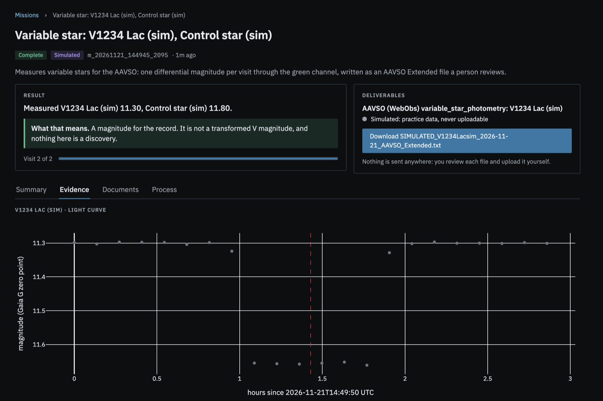
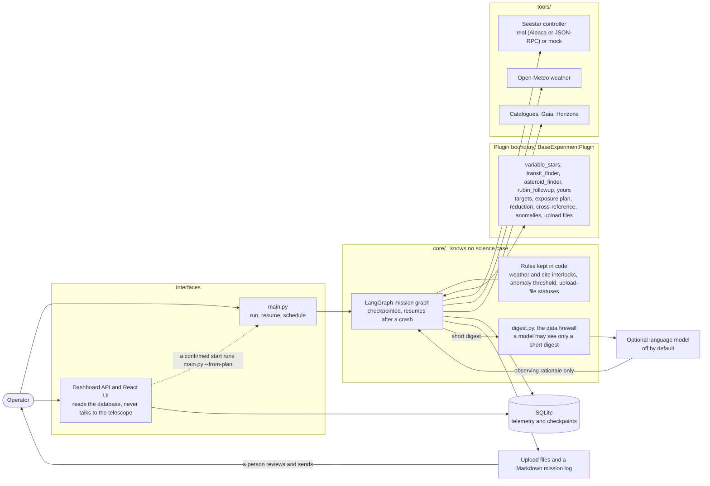
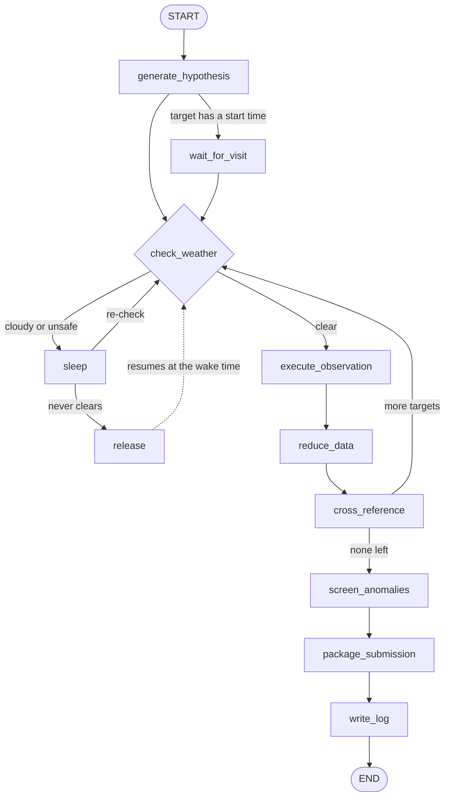

# 🔭 Astronomo

> **Mission.** Help amateur astronomers contribute meaningfully to real science.
> See [the mission and how we will know](docs/mission.md).

Astronomo is a free, open-source, auditable pipeline that runs a small telescope (Seestar S50 Pro) under supervision, end to end: **fetch a network's targets → check weather → observe → reduce → cross-reference → prepare upload files → screen for anomalies → keep a mission log**. The core is **domain-agnostic** (mission state, weather gating, hardware, telemetry, upload files); a science case is a *plugin* ([Plugins](#plugins)). A language model is optional, off by default, and never in charge of safety.

**Take part in the networks, not rediscover what is known.** A 50 mm telescope supplies what the networks are short of, so
Astronomo takes targets from their own lists: [ExoClock](https://www.exoclock.space/) and [NASA Exoplanet Watch](https://exoplanets.nasa.gov/exoplanet-watch/) (transit times that keep an ephemeris fresh), the NASA Exoplanet Archive's timing-variation flag, the AAVSO Target Tool (variable-star magnitudes), the [Minor Planet Center](https://minorplanetcenter.net/)'s NEO Confirmation Page (astrometry for newly reported asteroids), and public Rubin alerts (transient photometry). Of these, only the variable-star and transit plugins are meant for use; the asteroid and Rubin plugins are drafts ([Plugins](#plugins)). The **default product is a database-ready upload file** (AAVSO or ADES) that a person reviews and sends; **Astronomo never sends anything itself**. Every night gets a Markdown mission log, and an anomaly (a significant timing offset, an unexpected dip, an outburst) is flagged in it for a person to review.

## The Goal

Help amateur astronomers contribute meaningfully to real science. The full scientific loop is the aim: **propose** what to observe, **observe** it, **analyze** the data, **test** the findings, then **submit** or **rework** and go round again. A language model takes on that loop one small, checked decision at a time, and the safety interlocks always stay in code.

The modest aim for one telescope is narrower: take part in the networks that are short of data, and hand a person a file they can review and send. That is spelled out in [the concrete goal](docs/mission.md#the-concrete-goal-what-astronomo-can-meaningfully-contribute). How far it gets today is in [Status and roadmap](#status-and-roadmap) below.

**Status in short.** The pipeline works end to end in simulation and is covered by tests. On a real Seestar S50 Pro it has finished two short supervised variable-star visits, and the magnitudes agree with Gaia within their quoted errors. It has not yet done a clean 40-frame night, produced a live AAVSO file, or seen a transit.

> **Use at your own risk.** This software can drive a real telescope. It is provided as is, with no warranty, and the
> operator is responsible for the equipment. Pointing a telescope at or near the Sun can destroy its optics and sensor
> and cause eye injury; the built-in interlocks reduce that risk but do not remove it. Supervise the first runs, and read
> [Real hardware](docs/real-hardware.md) first.



*The dashboard's page for a finished mission, here a simulated one: the result, what it means, the file a person reviews (never sent by Astronomo) and the light curve. The star and the eclipse are practice data, not a real star. [More on the dashboard](#4-watch-it-in-the-dashboard-optional).*

## Quick start

Everything in this section runs with **no hardware, no API key and no cost**. To add a language model, see [Choose a model](docs/models.md#choose-a-model-local-cloud-or-none).

### 1. Install

```bash
cd astronomo
python3 install.py    # Python 3.10 or newer. Creates .venv, installs, writes .env, runs a fast simulation (the default plugin).
```

`install.py` asks only for an upload identity (observer name, AAVSO code, MPC station code, site). Leave any answer blank. It does not ask for a key, and it leaves the telescope mock on. The same steps by hand:

```bash
python3 -m venv .venv
source .venv/bin/activate
pip install -r requirements.txt          # the same packages as pyproject.toml
cp .env.example .env                     # optional for simulation
```

### 2. Run a simulated variable-star visit

```bash
python main.py --plugin variable_stars --simulate --fast   # under a minute: sub-second mock exposures
```

Drop `--fast` for real-length mock exposures (several minutes). Interrupt with Ctrl-C and run the same command again: the mission is checkpointed and **resumes** from the last completed node.

`--simulate` = mock telescope **and** offline weather/catalogs (deterministic stand-ins, every record tagged `simulated`). `--simulate --live-services` keeps the telescope mocked but uses real Open-Meteo / JPL Horizons / Gaia. That exercises the network plumbing only: the synthetic images don't match the real sky, so catalog matches are meaningless in that mode.

### 3. Read the result

A successful run ends like this (numbers vary slightly with the clock). Simulated files are prefixed `SIMULATED_` and can never be marked ready to upload:

```
Mission m_20261120_222949_1537 finished: COMPLETE
  observations: 2
   - V1234 Lac (sim): A minimum: depth 27.8 %, duration 0.88 h, mid-time 2026-11-20 23:55 UTC, 10 comparison stars.
       cross-ref: eclipse on time: 11.300 +/- 0.030 mag, minimum at 2026-11-20 23:55 UTC.
   - Control star (sim): No minimum in 22 frames (rms 3.6 ppt). The night's brightness can still be measured.
       cross-ref: steady: 11.798 +/- 0.030 mag.
  upload files ({'simulated': 2, 'replay': 0, 'draft': 0, 'ready_for_review': 0, 'held': 0}); none are sent, a person reviews each:
   - [simulated] AAVSO (WebObs) variable_star_photometry: .../submissions/SIMULATED_V1234Lacsim_2026-11-20_AAVSO_Extended.txt -- simulated data: ...
   - [simulated] AAVSO (WebObs) variable_star_photometry: .../submissions/SIMULATED_Controlstarsim_2026-11-20_AAVSO_Extended.txt -- simulated data: ...
  2 candidate anomaly(ies) below the threshold; listed in the mission log
  mission log: .../log/mission_log_2026-11-20.md
```

Output lands in `data/` (override with `ASTRONOMO_DATA_DIR`): `astronomo.sqlite` (telemetry), `checkpoints.sqlite` (LangGraph state), and per mission `missions/<id>/`:

| Path | What it is |
|---|---|
| `frames/` | The FITS frames, one folder per target |
| `submissions/` | The upload files and a `manifest.json`. Nothing in it has been sent |
| `log/` | The mission log, a Markdown file. An anomaly at or above `ASTRONOMO_ANOMALY_MIN_SIGMA` (default 5) is flagged in it for a person to review; weaker ones are listed as below the threshold |

### 4. Watch it in the dashboard (optional)

Astronomo is a pipeline and does not need a browser; step 2 is a complete run. To watch and to plan, run `python -m dashboard.api` in a second terminal. It opens [http://localhost:8765](http://localhost:8765) (if that port is taken, pass `--port 8780` or set `ASTRONOMO_API_PORT`). That process is the HTTP API (`/api/v1`) and it serves the bundled React UI from `frontend/dist` (shipped, so you do not need Node unless you change the React source: `cd frontend && npm install && npm run build`). Plan, cancel, rehearse and start go through the API; a confirmed start runs `python main.py --from-plan`. The API does not talk to the telescope. The contract is [docs/api.md](docs/api.md). Point any other UI at the same `/api/v1`.

### 5. More commands

```bash
# Simulate (the plugins are listed with --list-plugins; each has a page under docs/plugins/)
python main.py --list-plugins
python main.py --simulate --fast                           # the default plugin, variable_stars
python main.py --plugin transit_finder --simulate --fast   # exoplanet transit timing, ~1 min
python main.py --plugin rubin_followup --simulate --fast   # a draft plugin: follow up Rubin alerts, ~1 min
python main.py --simulate --fast --cloudy-checks 2         # watch it go to SLEEP twice, then observe

# Plan and schedule
python main.py --from-plan 3 --simulate --fast             # rehearse a plan; the real run is ASTRONOMO_MOCK_MODE=false python main.py --from-plan 3
python main.py --schedule --once                           # list what is due; starts nothing
python main.py --fetch-forecast                            # save the forecast before joining the telescope Wi-Fi

# Test
pytest -n auto                                             # whole suite on every core, about 4 to 5 minutes; a few tests skip without a real Ollama
pytest -n auto -m "not slow"                               # skips the tests that run a whole simulated mission; about 4 to 5 minutes too on a laptop (2026-11-21)
cd frontend && npm test                                    # React render smoke (Node 18+; not part of pytest, so a Python-only install stays Node-free)
```

### 6. Before any real upload

Set `ASTRONOMO_OBSERVER_NAME`, `ASTRONOMO_AAVSO_OBS_CODE` and
`ASTRONOMO_MPC_STATION_CODE`. Without them a file is still written, but as a `DRAFT_` with the missing item listed as a
blocker. How strong an anomaly has to be before the mission log flags it is `ASTRONOMO_ANOMALY_MIN_SIGMA` (default 5); see [Configuration](docs/configuration.md).

**What the codes do.** They are identities the AAVSO and the MPC assign to you, and Astronomo only writes them into the
upload files it prepares. It does not log in anywhere, send anything, or use them to choose targets.


| Setting                      | Get it from                                                                                                    | Written into                | Used by                                                                                           |
| ---------------------------- | -------------------------------------------------------------------------------------------------------------- | --------------------------- | ------------------------------------------------------------------------------------------------- |
| `ASTRONOMO_AAVSO_OBS_CODE`   | The AAVSO, free: [how to request it](docs/first-light/01-aavso-observer-code.md)                               | The `#OBSCODE=` header line | `transit_finder` (AAVSO Exoplanet Report), `rubin_followup` and `variable_stars` (AAVSO Extended) |
| `ASTRONOMO_MPC_STATION_CODE` | The MPC, and a 50 mm telescope may not qualify: [read this first](docs/first-light/04-mpc-observatory-code.md) | The ADES observatory code   | `asteroid_finder` (MPC ADES)                                                                      |


With a code set, the "missing code" blocker goes away; a file can still be a `DRAFT_` for other reasons (for example a host
star that was not confirmed). `SIMULATED_` and `REPLAY_` files stay blocked whatever you set. To upload, you open the
file and submit it yourself on the AAVSO's or the MPC's site; the AAVSO form also needs a site and an equipment package in
your account (same page as above).

## Connect a real Seestar

The steps above need no telescope. This is how a Seestar S50 Pro (firmware 9.75) was connected. There are two ways to put the computer and the telescope on one network. **Use station mode (A) at home.** It keeps the internet, which the weather check and the Gaia comparison stars need during a mission. It has been tested at the bench only, not yet on the sky.

1. In the Seestar app, update the firmware. This unit was updated to **9.75**. Leave any later update until the check below has run.
2. **A. Station mode (the telescope joins your home Wi-Fi; tested 2026-11-20).**
   1. **Check your router's address range first.** Station mode fails with "network connect failed", after the Wi-Fi seems to join, when the router uses **`10.0.0.x`**. ZWO blocks that range because the telescope's own Wi-Fi uses it, and Xfinity gateways use it by default. To see yours, look at the address of the gateway your computer uses (macOS: `route -n get default | grep gateway`). If it starts `10.0.0.`, change the router to another range such as `192.168.1.x`. On an Xfinity gateway, open `http://10.0.0.1` (default login `admin` / `password` unless you changed it), then **Gateway**, **Connection**, **Local IP Network**, and change the first three parts of the Gateway Address, DHCP Beginning Address and DHCP Ending Address from `10.0.0` to `192.168.1`. The Xfinity app has the same setting under Connect, View WiFi equipment, Advanced Settings, LAN & WAN. **This changes the address of every device at home**, so reboot them afterwards, including any second router. Some rented gateways may not allow the change.
   2. In the Seestar app, open the Wi-Fi settings, turn on **Station Mode**, pick your home network and enter its password. Keep the telescope near the router. If it still fails, reset the telescope's Wi-Fi (the button on the base) and try again, switch cellular data off for the Seestar app, and try the 2.4 GHz band (some routers merge both bands under one name, which can make the telescope flip bands and lose station mode).
   3. Unplug any USB cable from the telescope. While it is mounted as a drive it does not answer on the network.
   4. In the app, open **Device management**, then **Assistive Features**, and switch on the **Alpaca** server. It stays off until you do, and a Wi-Fi change can switch it off again. Then close the Seestar app completely, so it is not holding the connection, and wait a minute or two.
   5. Find the telescope's address (the app's Wi-Fi details, or your router's device list). Check that it answers, with your own address in place of the example:

      ```bash
      curl "http://192.168.1.200:32323/management/v1/configureddevices"
      ```

      It lists the telescope, two cameras, two focusers, a filter wheel and a switch. The telescope's address can change, because it comes from your router. If your router lets you reserve it for the telescope, do (some, including a rented Xfinity gateway, may not). If it does not, leave `ASTRONOMO_SEESTAR_HOST` at its default, `seestar.local`: the name resolved to the telescope on this network, and `--hardware-check` passed with it (2026-11-20). If a name lookup is dropped on your network (guest networks and some switches do this), use the address instead and look it up again when the connection fails. Alpaca has no password, so anyone on the network can send it commands.
   6. Set `ASTRONOMO_SEESTAR_HOST` to that address, or leave it as `seestar.local` (step 4 below).
3. **B. The telescope's own Wi-Fi (the way it was first connected, 2026-11-13).** Connect the computer to the telescope's Wi-Fi (`S50_xxxxx`, address `10.0.0.1`). That network has no internet, and the computer loses every other network while it is joined. Fetch the forecast first (`python main.py --fetch-forecast`). If you need both here, tether a phone over USB for internet and put the tether above Wi-Fi in the macOS service order. That has not been tried with this telescope, and it breaks if the other network is also `10.0.0.x`.
4. In `.env`, set `ASTRONOMO_SEESTAR_TRANSPORT=alpaca`, and for station mode `ASTRONOMO_SEESTAR_HOST` to the telescope's address. Firmware 7.18 and newer needs the Alpaca transport: the default JSON-RPC transport wants a handshake Astronomo does not do. Set your site as well. A real run refuses the Denver placeholder.
5. Run the smoke test. It connects, reads the scope and parks. It does not slew or take a picture, and it needs no plan, no forecast and no internet:

```bash
ASTRONOMO_SEESTAR_TRANSPORT=alpaca ASTRONOMO_SEESTAR_HOST=192.168.1.200 python main.py --hardware-check
```

`--hardware-check` turns the telescope mock off for that one command. `--no-park` skips the park (use it when you do not want the arm to move). `--simulate` runs the same steps against the mock. Passed over station mode on 2026-11-20 with `--no-park`, with the computer also able to reach Open-Meteo and the Harvard VizieR mirror. A full mission over station mode has not been run yet.

What this telescope has not yet answered is the [open hardware questions](docs/first-light/05-first-light-checklist.md). Why the JSON-RPC handshake is not implemented is in [the firmware note](docs/first-light/03-firmware-and-authentication.md); host, port and other settings are in [Configuration](docs/configuration.md). Read [Real hardware](docs/real-hardware.md) and [the first-mission note](docs/first-light/06-first-mission.md) before a mission.

## Architecture



- **The plugin boundary.** `core/` and `tools/` know no science case. A plugin supplies targets, an exposure plan, the reduction, the cross-check, the anomaly proposals and the upload files; core runs the mission and decides the statuses. Adding a science case does not touch core ([Writing a plugin](docs/writing-a-plugin.md)).
- **Rules stay in code.** Weather gating, site interlocks, parking, the anomaly threshold and which upload files can be marked ready are plain Python. A plugin or a model cannot lower them.
- **The data firewall.** A model never receives raw data, FITS paths, tables or findings. It sees a short digest of scalar fields, and `core/digest.py` rejects anything larger or array-like before it is sent.
- **The model's role.** Optional and advisory. Today it writes one thing, the observing rationale shown on the dashboard. Nothing it writes gates weather, hardware, detections or the files ([Language models](docs/models.md#language-models-optional)).
- **Nothing is sent.** Astronomo writes files; a person reads each one and submits it from their own account.

The code layout, what a mission produces and what is stored are in [docs/architecture.md](docs/architecture.md).

## How a mission runs




| Node                  | What it does                                                                                                                                                                     |
| --------------------- | -------------------------------------------------------------------------------------------------------------------------------------------------------------------------------- |
| `generate_hypothesis` | `plugin.generate_targets()` → validate, rank by priority, cap at `MAX_TARGETS`. Each target says which network chose it and why (`network.sources`, `task`, `reason`, `score`).  |
| `wait_for_visit`      | Only for a target that has a start time (a scheduled visit, or a survey replay): blocks on the mission clock until it is due (status `WAITING`). |
| `check_weather`       | Open-Meteo. **Cloud cover > 30 %** (or wind, precipitation, missing data, or — on real hardware — Sun above −12°) → status `SLEEP`.                                              |
| `sleep`               | Wait, re-check; after `MAX_SLEEP_CYCLES` the mission is `ABORTED` (and still screens, packages and logs whatever it already has).                                                |
| `release`             | If the weather never clears, the mission keeps a wake time and hands the process back instead of aborting; the scheduler resumes it. |
| `execute_observation` | `plugin.get_exposure_plan()` + `SeestarController.capture_sequence()` → FITS files.                                                                                              |
| `reduce_data`         | `plugin.analyze_frames(fits_paths)` → structured findings.                                                                                                                       |
| `cross_reference`     | `plugin.cross_reference(findings, catalogs, target)`; catalog outages are recorded, not fatal.                                                                                   |
| `screen_anomalies`    | `plugin.detect_anomalies()` proposes leads with a significance in sigma; **core** keeps only those at or above `ANOMALY_MIN_SIGMA`, so a plugin cannot talk itself into raising an alarm. |
| `package_submission`  | `plugin.build_submissions()` → upload files + `manifest.json` in `submissions/`. A draft with missing information is held back or marked `DRAFT_`; nothing is sent.              |
| `write_log`           | Writes the **mission log** as Markdown (no model-written text), including any anomaly flagged for a person to review.                                                            |


Archive missions skip `check_weather` (a survey's conditions are part of its data) and wait on the replay clock instead. See
[Real data and long cadences](docs/real-data.md).

**Failure policy:** an exception in any node marks the mission `FAILED` (message stored, mission stops), except a
transient network or link error, which is retried a few times with backoff first (`ASTRONOMO_NODE_RETRIES`). A device
error is never retried. Telescope errors park the mount. Weather outages fail *safe* (sleep).

## Plugins

A science case is a plugin. Four ship with Astronomo, and `variable_stars` is the one that has measured a magnitude on this telescope. Each page says what its numbers do and do not mean.

**Two are drafts, not ready for use: `asteroid_finder` and `rubin_followup`.** They are kept and tested, and they run in simulation and (for the asteroid plugin) on the ZTF replay, but neither has run on a real telescope. `--list-plugins` marks them, their dashboard header and mission logs say "DRAFT", and a real-telescope run with one is refused unless you set `ASTRONOMO_ALLOW_DRAFT_PLUGINS=1`. `transit_finder` is ready in the sense that it is simulation-proven; no real transit has been measured with it yet, on this telescope or on archive data (Phase 5).


| Plugin | Status | Targets come from                                                                                                                                                                                              | Produces (default output)                                                                 | Anomaly flagged in the mission log                                                                  | Details                                                          |
| --- | --- | -------------------------------------------------------------------------------------------------------------------------------------------------------------------------------------------------------------- | ----------------------------------------------------------------------------------------- | ---------------------------------------------------------------------------------------------- | ---------------------------------------------------------------- |
| `variable_stars` | ready (default) | The AAVSO Target Tool's public list (stars that want data, by filter and cadence). A saved window is a usable night, not an eclipse                                                                            | One **AAVSO Extended** magnitude per visit (green channel `TG`, Gaia comparison ensemble) | An eclipse off its predicted time, an outburst, or a Mira far from a predicted maximum         | [docs/plugins/variable_stars.md](docs/plugins/variable_stars.md) |
| `transit_finder` | ready (simulation only) | ExoClock + NASA Exoplanet Watch, ranked by how stale each planet's published ephemeris is, boosted by ExoClock priority and the NASA Exoplanet Archive's TTV flag. Tasks: ephemeris refinement, TTV monitoring | One **AAVSO Exoplanet Report** per transit time series (BJD_TDB, relative flux)           | Mid-transit time far from the ephemeris (TTV), a missing transit, a dip where none is expected | [docs/plugins/transit.md](docs/plugins/transit.md)               |
| `asteroid_finder` | **draft** | MPC NEO Confirmation Page when anything is within reach (rarely: it is nearly all fainter than a 50 mm telescope can see), else a labelled built-in list of bright known asteroids                             | **MPC ADES** astrometry, only for tracks matched to a designation or a NEOCP object       | None proposed yet                                                                              | [docs/plugins/asteroid.md](docs/plugins/asteroid.md)             |
| `rubin_followup` | **draft** | Public Vera C. Rubin alerts via the Fink broker, plus an optional watchlist                                                                                                                                    | One **AAVSO Extended** photometry line per alert (a magnitude or a fainter-than limit)    | An **outburst**: detected much brighter than Rubin's own light curve predicts                  | [docs/plugins/rubin.md](docs/plugins/rubin.md)                   |


Real-data check: the asteroid pipeline recovered a mover in ZTF images of asteroid 8191 whose position and rate match
Horizons. The transit plugin has no real-data check yet, and the Rubin plugin has not been run live (the alert stream
was dark). The ZTF recovery is a pipeline demonstration, not a measurement or a discovery claim; "unidentified" means
only "not explained by the objects queried". Which network
clients have run live is under [Known limitations](#known-limitations--v1-gaps). To add your own science case, see
[Writing a plugin](docs/writing-a-plugin.md).

## Status and roadmap

**What has been seen.**

- **In simulation:** a whole mission runs with no hardware or network (`python main.py --simulate`), and the test suite passes (2 tests skip because they need a real Ollama).
- **On a real telescope:** a Seestar S50 Pro (firmware 9.75) over Alpaca finished two short supervised variable-star visits (Hat-P-23, 2026-11-18, 12 frames each). The reanalysed magnitudes agree with Gaia G within their quoted errors. The telescope has also been reached over a home network with the internet at the same time (a bench check, 2026-11-20; see [Connect a real Seestar](#connect-a-real-seestar)).
- **Not yet seen:** a clean 40-frame night, a whole mission over station mode, a live AAVSO file, a transit.

[Status](docs/status.md) says, stage by stage, what has and has not been seen on a real telescope, and the roadmap's [Now](ROADMAP.md#now) section says what is next. The model's role is deliberately small and grows one bounded, validated decision at a time; safety interlocks always stay in code.

Phases in order (each has numbered sub-phases and exit criteria in [ROADMAP.md](ROADMAP.md)):

1. **Public release:** a license, an honest README with a screenshot and diagram, the Python versions that work named, tidy docs, a findings package for each night, and then the repository made public with branch protection on.
2. **First clean night:** the scope kept awake while connected, a recipe for repeating a night, then one supervised 40-frame variable-star visit on a real Seestar with nothing assumed: a live forecast, a reachable Gaia mirror and an AAVSO file written on the run.
3. **First accepted file:** retry buttons so a failed outside call never strands a night, and a file the AAVSO accepts.
4. **Steady and unattended:** a scheduler proven on the mount, multi-night missions, campaigns that combine many nights of one target into one package, a planner that proposes the nights for a person to approve, a quoted systematic error on every result, science claims stated no more strongly than the evidence allows, and safety checks for running without someone watching.
5. **Transits:** a known transit with its mid-time inside its error, and a measured timing error.
6. **Autonomy:** the model proposes missions and evaluates data inside the deterministic graph, findings are tested by follow-up, and models are compared.
7. **Reach:** a plugin directory, sending files through each network's real channel behind human approval, more science cases and multi-telescope coordination.

## Documentation


| Page                                                                                         | What is in it                                                                                                                                                                             |
| -------------------------------------------------------------------------------------------- | ----------------------------------------------------------------------------------------------------------------------------------------------------------------------------------------- |
| [docs/models.md](docs/models.md)                                                             | Choosing and setting up a language model (none, Ollama, Anthropic, OpenAI), cost controls, the data firewall, caveats                                                                     |
| [docs/configuration.md](docs/configuration.md)                                               | Which settings matter for a simulation, an upload, and everything else, and which value wins                                                                                              |
| [docs/real-hardware.md](docs/real-hardware.md)                                               | **Read before using a real Seestar**: what is untested, safety interlocks, what is missing                                                                                                |
| [docs/first-light/05-first-light-checklist.md](docs/first-light/05-first-light-checklist.md) | Open hardware questions on the Alpaca path, and what the 2026-11-13 night already answered                                                                                                |
| [docs/first-light/06-first-mission.md](docs/first-light/06-first-mission.md)                 | The runbook for the first clean night: a 40-frame variable-star visit on a real Seestar, with nothing assumed                                                                             |
| [docs/first-light/08-first-transit.md](docs/first-light/08-first-transit.md)                 | The first transit mission, kept for its own later phase                                                                                                                                   |
| [docs/mission.md](docs/mission.md)                                                           | What Astronomo is for, what it holds itself to, and how we will know it is working                                                                                                        |
| [docs/dashboard.md](docs/dashboard.md)                                                       | The dashboard's pages and design rules (colour, type, charts)                                                                                                                             |
| [docs/status.md](docs/status.md)                                                             | What is real on a real telescope and what is not yet, stage by stage                                                                                                                      |
| [docs/journal.md](docs/journal.md)                                                           | Field journal: what happened on each real night, and what was found                                                                                                                       |
| [docs/decisions.md](docs/decisions.md)                                                       | Why it is built this way, and the architecture's strengths and gaps                                                                                                                       |
| [docs/plugins/variable-star-feasibility.md](docs/plugins/variable-star-feasibility.md)       | Why variable-star photometry is the stronger case than transits: evidence, the site census, and the risks still open                                                                      |
| [docs/first-light/07-science-options.md](docs/first-light/07-science-options.md)             | What else a Seestar S50 Pro and Astronomo could do (transits, variable stars, supernovae, comets, asteroids, occultations), with success odds and how valuable each contribution would be |
| [docs/real-data.md](docs/real-data.md)                                                       | Replaying real survey data, mission clocks, resuming and running several missions                                                                                                         |
| [docs/writing-a-plugin.md](docs/writing-a-plugin.md)                                         | The plugin contract, real-data sources, dashboard views, simulating your experiment                                                                                                       |
| [docs/architecture.md](docs/architecture.md)                                                 | Code layout, the mission log writer, telemetry, headless pipeline and optional UIs                                                                                                              |
| [docs/api.md](docs/api.md)                                                                   | HTTP API (`/api/v1`): the contract for any frontend                                                                                                                                       |


## Known limitations / v1 gaps

Beyond the real-hardware gap and the open ends of the loop (both above), the main ones are below. The complete list
is "What is not real yet" in [status](docs/status.md#what-is-not-real-yet).

- **Field rotation is measured and corrected, and the limits are still guesses.** Registration applies a rotation about the frame centre plus a shift. On the Hat-P-23 visits it was 1.64° and 0.84°, and both were corrected. The warn and fail limits (`warn_rotation_edge_px` 1.5, `max_rotation_edge_px` 4) have not been re-set from a clean night.
- **The observing site must be set.** It defaults to a Denver placeholder; set yours in the dashboard or with the `ASTRONOMO_SITE_*` settings.
A real-telescope run refuses to start until you do. The horizon is a few points you type, not a measurement.
- **The scheduler does not start a night by itself.** `python main.py --schedule --once` lists due plans and resumes a
mission that was waiting on weather. A plan starts with `--confirm ID`, or with `python main.py --from-plan ID`.
Self-start stays off until the interlocks and parking have been confirmed on this mount. Archive replays still hold a
process while they wait. Observing windows, altitude, Sun and Moon separation are enforced on telescope
missions, but those interlocks have been tested only in simulation. `python main.py --stop` parks and does not resume.
- **Real-data results are demonstrations, not measurements.** Photometry is instrumental (SNR assumes ~1 e⁻/ADU) and on
the Gaia G scale, not a V-band standard (coded `CV`, `TRANS=NO`); there is no quoted systematic error, and SkyBoT/MPC
are not consulted (see the [plugin pages](docs/plugins/)).
- **The mission log is deterministic.** It is Markdown, built from the mission record with no model-written text, and is
written every time. A model, if you attach one, writes only the observing rationale shown on the dashboard.
- **Upload files are checked against published format specifications, not by uploading them.** The AAVSO Exoplanet
report uses `Rnflux` per the current format but was not accepted by their upload page. The draft now attaches a
field image of the first frame with the target and comparison stars marked. That image is the stars the light
curve used, not a new plate solution, and a real Seestar frame has not been checked against the upload page.
Run each file through the destination's validator, and read it, before sending.
- **The four target lists have been fetched live** (ExoClock on 2026-11-14, the others on 2026-10-28;
[details](docs/real-data.md)). If neither ExoClock nor Exoplanet Watch can be read (and no cache exists) the transit
plugin falls back to a built-in list, as does the asteroid plugin when the NEOCP offers nothing; the mission log
labels such targets `manual`.
- **The 50 mm aperture limits what the networks can use.** ExoClock asks for 5-inch-class telescopes and will not list a
Seestar as a contributor, so Astronomo applies its own brightness and depth limits. Almost every NEOCP object is far
too faint. Variable-star photometry has measured a Gaia G magnitude on this telescope (Hat-P-23, 2026-11-18). The live
AAVSO file was held because that visit ran on the telescope's own Wi-Fi, which has no internet (station mode on a home network avoids this; not yet used on the sky). A listed window is a usable night, not an eclipse.
- **Parallel missions:** several can share a data directory, one process each, but two *telescope* missions would
compete for the one telescope, so only archive missions are meant to run in parallel.

Tested with Python 3.10, langgraph 1.2, photutils 2.0, astropy 6.1, fastapi 0.115.

## Contributing

The most useful contribution right now is an honest report of a night on a real Seestar, above all a clean 40-frame variable-star visit run over station mode ([how to connect](#connect-a-real-seestar)); second is a plugin for another science case. [CONTRIBUTING.md](CONTRIBUTING.md) has the ground rules (nothing is sent
by the software, quoted errors must be true, unconfirmed hardware behaviour is labelled as such), how to set up and run
the tests, and how to report a night or a problem. Safety and security reports go through [SECURITY.md](SECURITY.md).

## License

Astronomo is released under the [Apache License 2.0](LICENSE) (see also [NOTICE](NOTICE)).

**No warranty.** As the license says, the software is provided "AS IS", without warranties or conditions of any kind,
and the authors are not liable for damage to equipment, injury, or data submitted to any network. Hardware use is at your
own risk (see the Status note at the top); read [Real hardware](docs/real-hardware.md) before use, and review every
upload file before you send it.

**Not affiliated.** Astronomo is an independent, community project. It is not affiliated with, endorsed by or sponsored
by ZWO (the maker of the Seestar), NASA, the AAVSO, the Minor Planet Center, ExoClock, the Vera C. Rubin Observatory,
or any other organisation, service or data provider named in this repository. Product, organisation and service names are
used only to say what the software works with, and belong to their owners. Its Seestar driver follows the community's
reverse-engineered notes, not ZWO documentation, and ZWO does not support it.