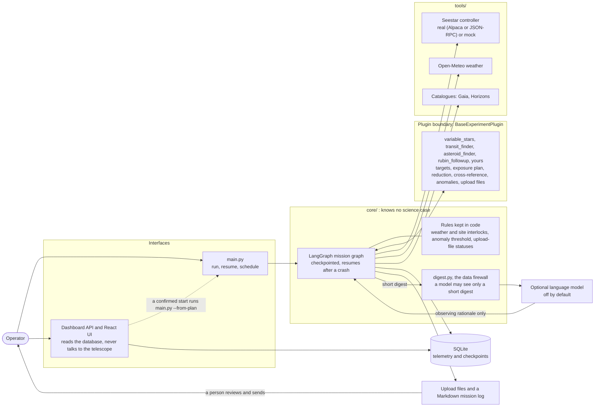
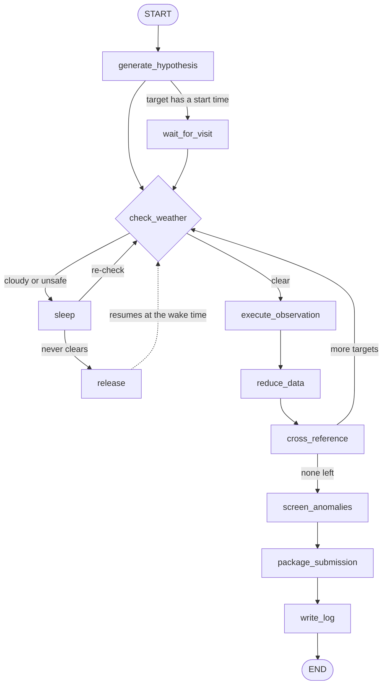

# Architecture and layout

How the code is organised, how a mission runs, what a mission produces (upload files and a mission log) and what is stored. The README has a smaller diagram of the overall shape ([How it fits together](../README.md#how-it-fits-together)).

## The overall shape



- **The plugin boundary.** `core/` and `tools/` know no science case. A plugin supplies targets, an exposure plan, the reduction, the cross-check, the anomaly proposals and the upload files; core runs the mission and decides the statuses. Adding a science case does not touch core ([Writing a plugin](writing-a-plugin.md)).
- **Rules stay in code.** Weather gating, site interlocks, parking, the anomaly threshold and which upload files can be marked ready are plain Python. A plugin or a model cannot lower them.
- **The data firewall.** A model never receives raw data, FITS paths, tables or findings. It sees a short digest of scalar fields, and `core/digest.py` rejects anything larger or array-like before it is sent.
- **The model's role.** Optional and advisory. Today it writes one thing, the observing rationale shown on the dashboard. Nothing it writes gates weather, hardware, detections or the files ([Language models](models.md#language-models-optional)).
- **Nothing is sent.** Astronomo writes files; a person reads each one and submits it from their own account.

## How a mission runs



| Node                  | What it does                                                                                                                                                                     |
| --------------------- | -------------------------------------------------------------------------------------------------------------------------------------------------------------------------------- |
| `generate_hypothesis` | `plugin.generate_targets()` → validate, rank by priority, cap at `MAX_TARGETS`. Each target says which network chose it and why (`network.sources`, `task`, `reason`, `score`).  |
| `wait_for_visit`      | Only for a target that has a start time (a scheduled visit, or a survey replay): blocks on the mission clock until it is due (status `WAITING`). |
| `check_weather`       | Open-Meteo. **Cloud cover > 30 %** (or wind, precipitation, missing data, or — on real hardware — Sun above −12°) → status `SLEEP`.                                              |
| `sleep`               | Wait, re-check; after `MAX_SLEEP_CYCLES` the mission is `ABORTED` (and still screens, packages and logs whatever it already has).                                                |
| `release`             | If the weather never clears, the mission keeps a wake time and hands the process back instead of aborting; the scheduler resumes it. |
| `execute_observation` | `plugin.get_exposure_plan()` + `SeestarController.capture_sequence()` → FITS files.                                                                                              |
| `reduce_data`         | `plugin.analyze_frames(fits_paths)` → structured findings.                                                                                                                       |
| `cross_reference`     | `plugin.cross_reference(findings, catalogs, target)`; catalog outages are recorded, not fatal.                                                                                   |
| `screen_anomalies`    | `plugin.detect_anomalies()` proposes leads with a significance in sigma; **core** keeps only those at or above `ANOMALY_MIN_SIGMA`, so a plugin cannot talk itself into raising an alarm. |
| `package_submission`  | `plugin.build_submissions()` → upload files + `manifest.json` in `submissions/`. A draft with missing information is held back or marked `DRAFT_`; nothing is sent.              |
| `write_log`           | Writes the **mission log** as Markdown (no model-written text), including any anomaly flagged for a person to review.                                                            |

Archive missions skip `check_weather` (a survey's conditions are part of its data) and wait on the replay clock instead. See
[Real data and long cadences](real-data.md).

**Failure policy:** an exception in any node marks the mission `FAILED` (message stored, mission stops), except a
transient network or link error, which is retried a few times with backoff first (`ASTRONOMO_NODE_RETRIES`). A device
error is never retried. Telescope errors park the mount. Weather outages fail *safe* (sleep).

## Layout

```
config.py              env-driven Settings (ASTRONOMO_* variables), active plugin, MOCK_MODE
main.py                CLI: loads the active plugin dynamically, runs/resumes missions
core/
  base_plugin.py       BaseExperimentPlugin ABC + contract validation
  state.py             MissionState (TypedDict), status enum, JSON sanitiser
  graph.py             LangGraph state machine, SQLite checkpointing, telemetry mirroring
  llm.py               model-agnostic client: Ollama / OpenAI-compatible / Anthropic, budgets, cache, ledger
  digest.py            the data firewall: only concise JSON digests may reach a model
  clock.py             mission clocks: wall time, or a replay clock (survey time at N x speed, or jumping)
  archive.py           ArchiveSource contract (frames from a public survey) + a retrying HTTP helper
  lease.py             ownership lease + heartbeat, so several processes can run missions side by side
  networks.py          Pro-Am target lists: cached/stale-tolerant fetch, name matching, the target `network` block and its validation
  site.py              the observing site: where it comes from (environment, `site.json`, placeholder), its horizon, and a place search
  interlocks.py        site interlocks: observing window, altitude, Sun and Moon separation, as pure rules the graph and the Opportunities page share
  planning.py          the hand-off from a planned observation to a mission (`main.py --from-plan`): re-check a plan, settle it when the mission ends
  opportunities.py     the shape (and validator) of an opportunity report: what a person could take part in, with reachable/blocked reasons and an impact estimate
  submission.py        SubmissionDraft + writing upload files: status, SIMULATED_/REPLAY_/DRAFT_ prefixes, manifest.json (never sends)
  anomaly.py           the anomaly screen (threshold enforced here, not by plugins) and the flags for a person to review
  mission_log.py       the automated mission log (a document spec built only from the mission record; no model text)
plugins/
  __init__.py          registry: load_plugin(name) -> instance (no core imports a concrete plugin)
  asteroid_finder/     example plugin: plugin.py = interface (and ADES drafts), reduction.py = detection,
                       mpc.py = the MPC NEO Confirmation Page as a target list,
                       scene.py = its simulated sky (the mover) and offline ephemeris stand-in,
                       ztf.py = real Zwicky Transient Facility images via NASA/IPAC IRSA (archive mode)
  transit_finder/      example plugin: plugin.py = interface, photometry.py = light curve + fit,
                       scene.py = simulated host star + night systematics, transit_model.py,
                       archive.py = NASA Exoplanet Archive client (incl. the TTV flag),
                       networks.py = ExoClock + Exoplanet Watch parsing, merge and staleness ranking,
                       opportunities.py = which listed planets this site can reach in the next 30 days, and what a timing is worth
  rubin_followup/      example plugin: plugin.py = interface, fink.py = Fink (Rubin alert broker) client,
                       photometry.py = stack, Gaia zero point, forced photometry, scene.py = simulated transient
  variable_stars/      AAVSO variable-star visits: plugin.py = interface and the Extended draft,
                       photometry.py = one magnitude from the transit reduction, scene.py = simulated eclipse,
                       networks.py = the AAVSO Target Tool list, opportunities.py = which listed stars this site
                       can reach, dashboard.py = the light curve
tools/
  weather.py           Open-Meteo wrapper (cloud, wind, precip, seeing *proxy*), fails safe
  telescope.py         SeestarController: real JSON-RPC over TCP, or mock FITS generator
  catalogs.py          astroquery Horizons; Gaia DR3 cone search via the Harvard VizieR mirror
  astrometry.py        WCS helpers, translation estimator, sun/target altitude (also vectorised), UTC <-> BJD_TDB
  upload_formats.py    pure writers for AAVSO Exoplanet, AAVSO Extended and MPC ADES files (they refuse what the spec forbids)
  imaging.py           background subtraction, star detection, frame times, green-channel extraction (shared by plugins)
  mock_sky.py          generic synthetic sky (stars, noise, WCS) + the SkyScene hook plugins fill in
writer/
  markdown_writer.py   renders the mission log's document spec as a Markdown file plus a figures/ folder
db/                    SQLAlchemy models (Mission, Target, Observation, Artifact, PlannedObservation, + telemetry) & repo
dashboard/api/         versioned HTTP API (`/api/v1`) and the bundled React UI from `frontend/dist`; does not talk to the telescope
dashboard/first_frame.py  first-frame picture and setup-check copy (reads missions/<id>/first_frame.png)
dashboard/frames.py    the first-frame view and every later FITS frame, stretched for a person to look at
dashboard/plans.py     plan helpers; Rehearse and a confirmed Start run `main.py --from-plan` (does not talk to the telescope)
dashboard/opportunities.py  reachable targets, windows, impact estimates, planning (reads the cached network lists; starts nothing)
dashboard/fleet.py     mission rows: lifecycle, liveness, visit/frame progress, wake-up times
dashboard/vocab.py     plain-language vs technical wording, state colours, lifecycle lanes, glossary
dashboard/plugin_ui.py plugin views: `summarise` (plain-language outcome), `evidence` (JSON for any frontend)
frontend/              React client of `/api/v1` (sources here; `dist/` is shipped so a checkout has a UI)
                       `cd frontend && npm test` mounts each route in jsdom (Node 18+; not part of pytest)
tests/                 pytest suite (Python only; serving `frontend/dist` is checked, JS is not executed)
```

**The rule:** `tools/` and `core/` know no science case. Anything that mentions a mover, a transit or any
other experiment -- its simulated objects, its offline stand-ins, its domain models and clients -- lives in that
plugin's package. `tests/test_scene.py` enforces it (shared tools may not mention a science case or import a plugin).

## Headless pipeline, bundled UI

`core/` and `main.py` run missions with no UI. Telemetry is SQLite (WAL). A browser is never required.

`python -m dashboard.api` is the bundled way to watch and to plan: it is the `/api/v1` contract and it
serves the React UI from `frontend/dist` (shipped, so a checkout does not need Node). A confirmed start
runs `python main.py --from-plan`. Nothing in `dashboard/` talks to the telescope. The contract is
[docs/api.md](api.md).

`frontend/` is the source of that React client. It lives in this repository for now; it may move to its
own repo. If `frontend/dist` is missing, `python -m dashboard.api` is still the API.

## What a mission produces

A mission ends with, in `missions/<id>/`:

- `submissions/`: the upload files and `manifest.json`. Core, not the plugin, decides each file's status:
  `simulated`, `replay`, `draft` (a blocker is listed), `ready_for_review` or `held` (no file written). Simulated and replayed
  data can never be `ready_for_review`, file names carry `SIMULATED_`/`REPLAY_`/`DRAFT_`, and `sent` is always `false`.
- `log/mission_log_<night>.md`: the mission log, always, as Markdown with a `figures/` folder beside it. It lists each target with
  its network, task and reason, what each observation found, the files and their blockers, and the anomaly screen's result
  (including what fell below the threshold, as leads for a person to check). It contains no model-written text, and carries the
  credit line for any replayed public data set.

An anomaly is a flag in the mission log.

A plugin proposes anomalies and drafts; **core enforces the bar and the statuses**, so a plugin cannot raise an alarm below the
threshold or mark a simulated file as ready. A failing `detect_anomalies` or `build_submissions` costs the mission only that output
(the error is recorded and the rest continues).

## The mission log writer

`core/mission_log.py` builds a *document spec* (title, sections, tables, figures) from the mission record, and
`writer/markdown_writer.py` renders it. The writer adds two generic sections: the observing log (the weather at the start of each
observation) and a reproducibility table (mission ID, plugin, language model use, Python and package versions). Table cells are
escaped so a pipe or a line break in a value cannot break a table. Simulated runs carry a **Simulation** banner. It is plain
Markdown on purpose: it diffs, searches and copies cleanly, a person can edit it before sharing it, and the dashboard serves the
same file as a download.

## Telemetry

Everything the dashboard shows is in SQLite (WAL mode, safe to read while a mission writes), except the live first-frame view: that PNG is written into the mission folder the moment the frame is on disk, and a UI reads the file so the operator sees it before the next exposure. The rest is in SQLite:
missions, targets, observations, artifacts (one row per upload file and per mission log), weather readings, and a `log_events` stream containing node
start/end/error markers plus all Astronomo log lines emitted while a node runs. `planned_observations` holds the notes a person made on the
Opportunities page (a target, its window, why, and the estimate shown at the time) and follow a life cycle: `PLANNED`, then `STARTED` (linked to
the mission built from it with `main.py --from-plan`, from the terminal or from a confirmed button on the Plans page), then `DONE` or `MISSED`; or `CANCELLED`. The Plans page lists every plan. `main.py --schedule` lists due plans and resumes a weather wait. It starts a plan only with `--confirm`. Self-start stays off until the mount has been confirmed.
